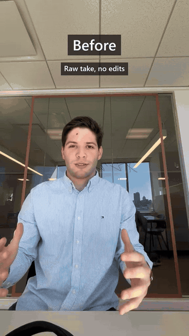
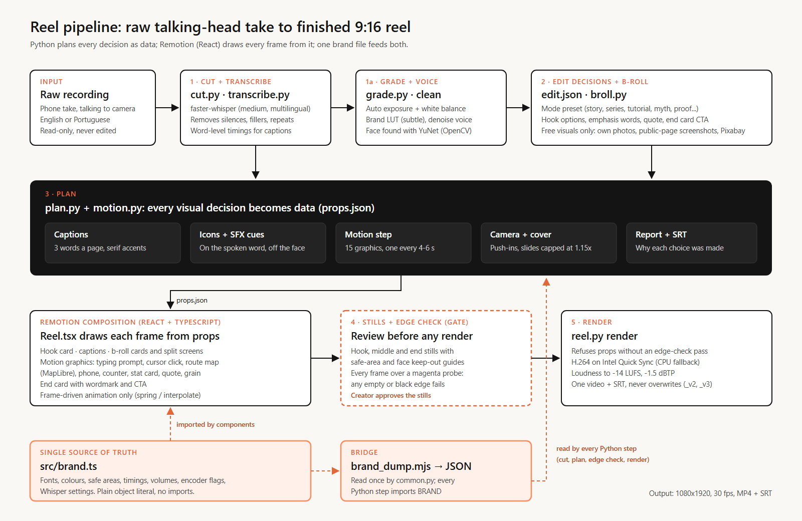
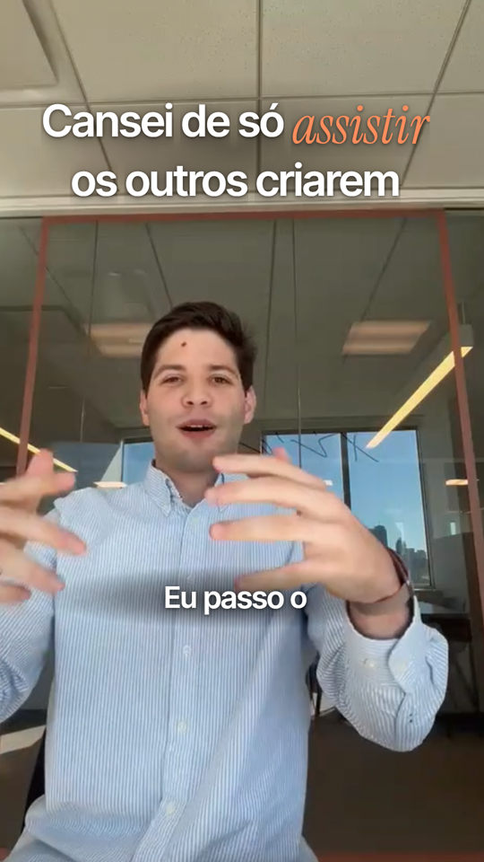
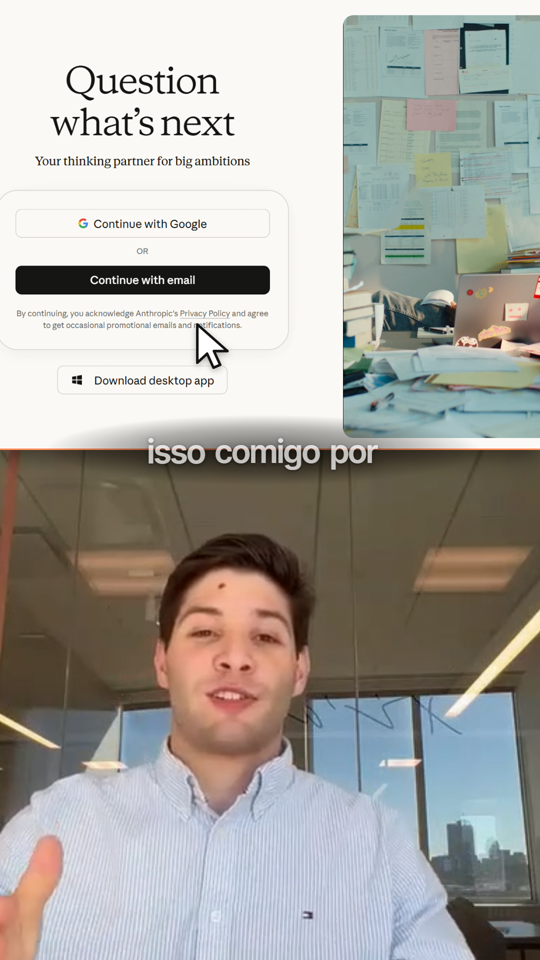
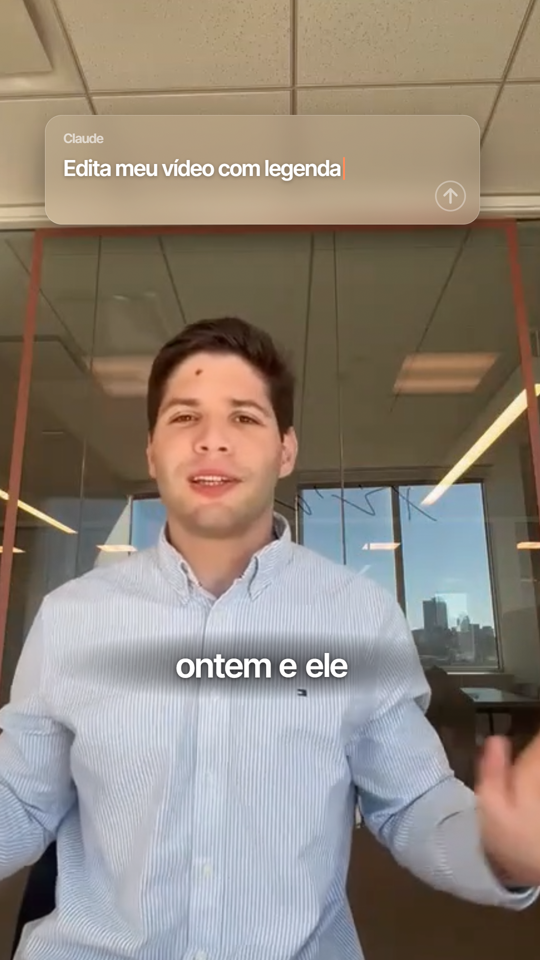
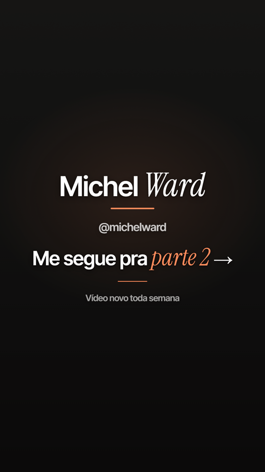
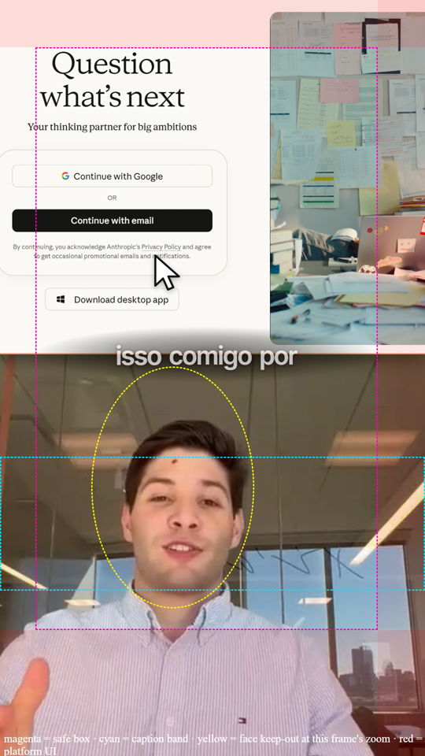

# Reel Pipeline: Automated Short-Form Video Editing (Case Study)

Solo project. I built a pipeline that turns a raw talking-to-camera recording into a finished TikTok / Instagram Reel (1080x1920, 30 fps): cut, colour, captions, b-roll, icons, sound effects, motion graphics and an end card, in English or Brazilian Portuguese. I built it with Claude Code as my pair programmer, and I use it for my own reels. This repository is a case study: the pipeline code stays private, and the code samples here are excerpts.

## Demo

*6 seconds of the raw take, then the first 18 seconds of the finished reel. [Full demo (24 s, MP4)](demo/before_after.mp4)*

From this take: 50.3 s raw, cut to 41.1 s (18% removed: silences, false starts), 24 camera moves, 5 motion graphics, 5 keyword icons and 13 sound cues. A new visual appears at least every 5 s. Final loudness is -14.5 LUFS.

## The problem

Editing a 45-second talking-head reel by hand is slow, and most of the work is repetitive:

* **Cutting** silences, ums and false starts, word by word.
* **Captions** timed to every word, with key words styled.
* **Visual rhythm.** Short-form video needs a new visual every 4 to 6 seconds, and each one has to match what is being said at that moment.
* **Consistency.** Fonts, colours, safe areas (where TikTok and Instagram draw their buttons) and loudness have to be the same in every video, or the brand looks improvised.

## What I built

| Stage | What it does |
|---|---|
| Cut + transcribe | Multilingual Whisper (medium) gives word-level timings; silences, fillers, hedges and repeated phrases are removed, and the cut report shows what went |
| Grade + voice | Automatic exposure and white balance metered on the face, a subtle brand LUT, and voice denoise / levelling when needed |
| Modes | Presets for structure and pacing: tutorial, series, story, day in the life, myth, proof |
| B-roll | Free sources only: my own photos, screenshots of public web pages (Playwright, no logins) and Pixabay |
| Plan | Captions (3 words a page, key words and numbers in a serif italic accent), keyword icons, sound cues, camera push-ins, motion graphics and the end card, all written as data with the reason for each choice |
| Motion graphics | 15 editorial effects in React: typing prompt box, cursor click and zoom on a screenshot, route line on a map, phone mockup, number counter, stat card, line chart, quote card, masked reveal, drawn underline and more |
| Checks | Review stills with safe-area and face keep-out guides; an automatic edge check on every frame |
| Render | H.264 on Intel Quick Sync with a CPU fallback, loudness normalised to -14 LUFS, plus an SRT subtitle file |

About 6,800 lines of Python and TypeScript, one command per stage (`reel.py cut`, `plan`, `stills`, `render`...), every script non-interactive.

## Architecture

* **Python plans, React draws.** Every decision (which word gets an icon, when a graphic appears, where the face is) is made in Python and written to a props file. The Remotion composition only draws frames from that file, so a plan can be reviewed, diffed and re-rendered without re-deciding anything.
* **One brand file.** `src/brand.ts` holds every font, colour, size, safe area, timing, volume and encoder flag. React imports it; Python reads it through a small Node bridge. See [03_brand_bridge.md](code-samples/03_brand_bridge.md).
* **Frame-driven animation.** Every motion uses `spring()` or `interpolate()` on the current frame, never CSS transitions, so renders are deterministic.

### Choosing motion graphics from what is said

The motion step reads the transcript and maps topics to graphics: AI talk becomes a typing prompt box, a website mentioned becomes a cursor clicking its screenshot, two places become a route on a map. It then resolves collisions with explicit rules: one graphic on screen at a time, starts at least 3.5 s apart, the same effect at most every 15 s, and overlays never touching the face (an ellipse from the YuNet face detector, scaled by the live camera zoom). Quote cards, stat cards and charts are only used with the creator's own quote or real numbers, never invented ones. See [02_motion_step.py](code-samples/02_motion_step.py).

### Never an empty edge

When a split screen or a card appears, the speaker slides aside. Slide too far and an empty band appears at the frame edge, which looks broken on a phone. Two layers prevent it:

1. While slid, the footage scales up around the face just enough that every edge still covers the frame, and the planner caps each slide so that scale stays at or under 1.15x.
2. Before rendering, every frame is rendered again over a magenta background and a 3 px strip along each edge is checked for magenta or pure black. The render command refuses to run without a pass for the exact props file (matched by hash).

See [01_edge_check.py](code-samples/01_edge_check.py).

## Tech stack

* **Rendering:** Remotion 4 (React + TypeScript), MapLibre GL JS with free OpenFreeMap tiles, Lucide icons
* **Pipeline:** Python 3, faster-whisper (CPU, int8), OpenCV (YuNet face detection), FFmpeg (Intel Quick Sync H.264, loudnorm)
* **Sources:** Playwright for screenshots of public pages, the Pixabay API for stock images and sound effects
* **Workflow:** Claude Code with project skills, one per stage (cut, captions, icons, sound, motion, b-roll, retention), each with a Gotchas section that records every correction

## Screenshots

Stills from the reel in the demo, rendered for review before the final render.

| | | |
|---|---|---|
|  |  |  |
| *Hook: one accent phrase, readable in 1.5 s* | *Split screen: cursor clicks a public page screenshot* | *Typing prompt box, clear of the face* |
|  |  | |
| *End card: wordmark, handle and CTA* | *Review overlay: safe box (magenta), caption band (cyan), face keep-out (yellow), platform UI (red)* | |

## Key decisions

1. **Stills and approval before every render.** A full render takes minutes; a set of review stills takes seconds and catches nearly every problem (a graphic on the face, a wrong word, a cramped hook).
2. **Checks that block, not warn.** The edge check is a gate on the render command. A warning in a log gets ignored; a refused render does not.
3. **Rules over taste, written down.** Every correction I gave becomes a rule in the code or in the stage's skill file (one accent per hook, no emoji stickers, no camera shakes, sentence case everywhere), so the same mistake does not come back next week.
4. **Zero spend.** Visuals come only from free sources. When nothing free fits, the fallback is an icon or an animated text card, not a paid stock clip.
5. **One deliverable by default.** One video with voice and sound effects plus an SRT. Platform-specific versions and a music version exist, but only on request, which keeps the output folder clean.
6. **Never overwrite a deliverable.** Re-renders get `_v2`, `_v3` suffixes automatically.

## What I learned

* **Make decisions data.** Once every choice lives in a props file with a reason attached, the editor becomes reviewable and fixes take one line instead of a re-edit.
* **Automate the check, not only the work.** The edge check exists because I spotted an empty band in one frame of a finished reel. Checking every frame automatically is cheaper than trusting my eyes on a few stills.
* **Most of the craft is restraint.** The rules that improved the reels most were limits: one graphic at a time, one accent colour, one quiet sound per motion.
* **A single source of truth pays for itself quickly.** Two languages (Python and TypeScript) reading one brand file removed a whole class of "why is this caption 4 px off" bugs.

## Files

* [demo/before_after.mp4](demo/before_after.mp4): 24 s before / after demo (720x1280, H.264)
* [demo/preview.gif](demo/preview.gif): 9 s preview
* [architecture.png](architecture.png): pipeline diagram ([architecture.svg](architecture.svg) is the editable source)
* [code-samples/01_edge_check.py](code-samples/01_edge_check.py): every-frame edge check that gates the render
* [code-samples/02_motion_step.py](code-samples/02_motion_step.py): choosing and placing motion graphics from the transcript
* [code-samples/03_brand_bridge.md](code-samples/03_brand_bridge.md): one brand file shared by TypeScript and Python
* [screenshots/](screenshots/): review stills
* [CREDITS.md](CREDITS.md): sound effects, fonts, icons, maps and software licences

The code samples are excerpts adapted from the private codebase and are not meant to run on their own.
